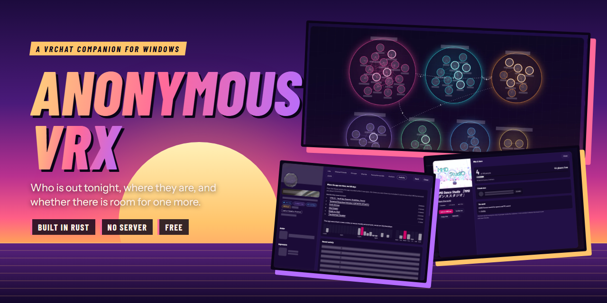
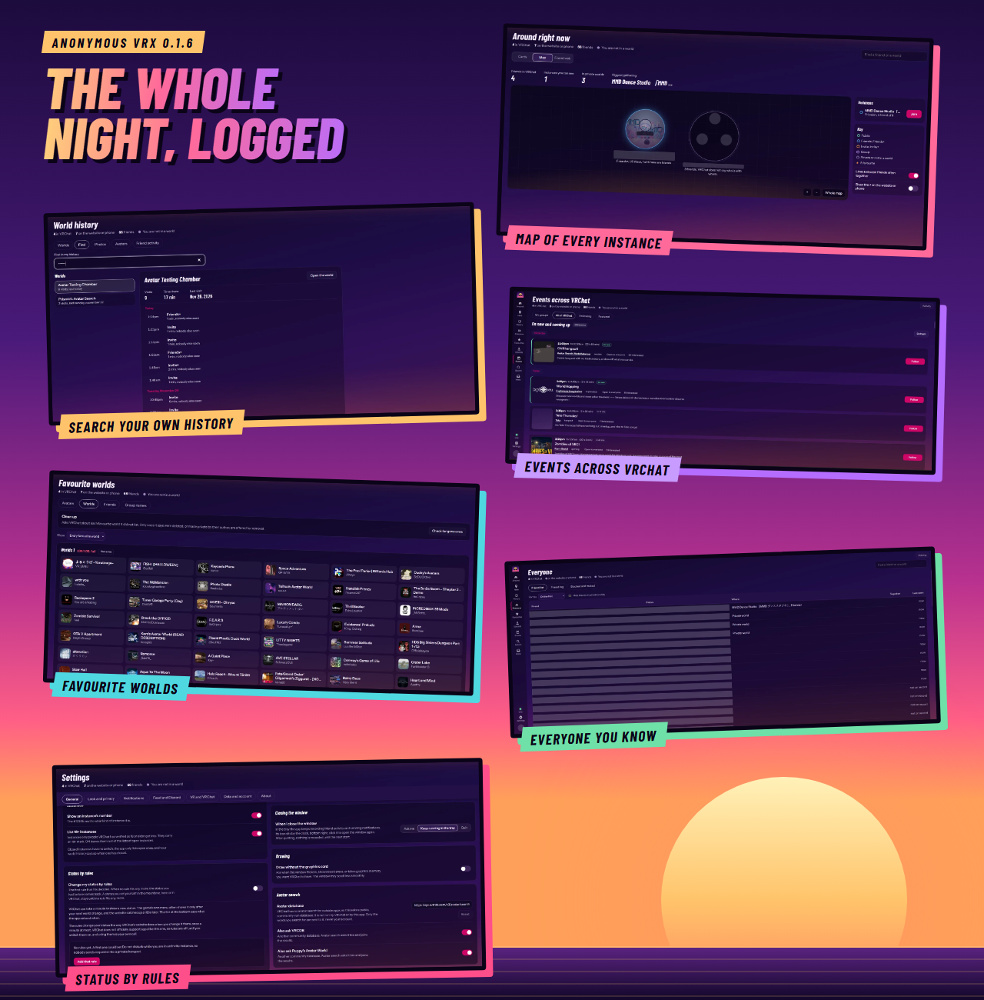

<p align="center">
  
</p>

<p align="center">
  <a href="https://github.com/ElDiablo66/anonymous-vrx-app/releases/latest"></a>
</p>
<p align="center">
  <a href="https://github.com/ElDiablo66/anonymous-vrx-app/releases/latest"></a>
  
  
  <a href="LICENSE"></a>
  
</p>

<p align="center">
  <a href="#get-it">Get it</a> ·
  <a href="#what-it-does">What it does</a> ·
  <a href="#privacy">Privacy</a> ·
  <a href="#known-limits">Known limits</a> ·
  <a href="#build-it-yourself">Build it</a> ·
  <a href="#licence-and-credits">Licence</a>
</p>

# Anonymous VRX

A VRChat companion for Windows that shows who is out tonight and where. It runs next to the game and answers the questions I kept digging through menus for:

- Who is out tonight, and which world are they in?
- Who is with them, and is there room for one more?
- What happened while I was away?
- Where was I last Tuesday at 2 am, and who else was there?

It all sits in one window, so you never have to open the VRChat website. I built it from scratch in Rust, with a neon sunset look.


<sub>Every picture here is my own app with "Hide names and pictures" switched on. The grey bars and circles are where my friends' names and pictures would be.</sub>

> Anonymous VRX is an independent project. It is not made by, affiliated with or endorsed by VRChat Inc. It uses the same web API as the VRChat website, which VRChat does not officially support for outside tools, so parts of it can break without notice.

## Get it

1. Open the [latest release](https://github.com/ElDiablo66/anonymous-vrx-app/releases/latest) and download `Anonymous-VRX-<version>-setup.exe`.
2. Run it. Everything is inside that one file.
3. Sign in with your VRChat account inside the app.

You need 64-bit Windows 10 or 11 and a VRChat account. Nothing else has to be installed first. It installs for your user only and needs no administrator rights.

The installer isn't code signed, so your browser may hold the download and Windows SmartScreen warns the first time you run it: choose Keep in the browser, then "More info" and "Run anyway". Each release lists the installer's SHA-256, and this repository is the only official place to get it.

From version 0.1.1 on, the app looks for a newer release here when it starts and installs it; Settings, About has the switch for that. Each update file is signed, and the app only installs one whose signature matches. Version 0.1.0 has no updater: quit the app and run the newer installer over the old one once. Your history and settings stay. To remove it, use "Installed apps" in Windows Settings.

## What it does

### See the night at a glance

Around is the screen the app opens on. Friends are grouped by the instance they share, with the world, access type, region, head count and how long each of them has been there. Favourites sit on top, one block per favourite group. Join, ask for an invite, invite yourself or copy the link with one click.


The Map view draws one bubble per instance with your friends in it, and the Friend web shows which of your friends know each other: each circle of friends is a district, friendships between circles are bridges, and a list names the friends who hold the circles together. The app asks VRChat about each friend only when you press the button, one at a time with a pause, and keeps the answer on your PC.

### Know where everyone hangs out


A profile's Activity tab shows the worlds where you two meet most, who is usually there too, and at which hours and weekdays. Below that are the worlds the app saw them in over the last 90 days. All of it comes from this PC's history.

### Never lose a night

VRChat forgets most of what happened. The app keeps it in a file on your PC: every instance you visited, for how long and who was there, read from VRChat's own log files. The Find tab searches that history by a person's name or part of a world's name, and from any past instance you can send yourself an invite or open its join page.


### And the rest of it

<p align="center">
  
</p>

<details>
<summary>The full list of what the app does</summary>

#### Around right now

| | |
|---|---|
| Friends by room | Friends are grouped by the instance they share, with the world, access type, region, head count and how long each of them has been there |
| Favourites on top | Favourite friends are pinned above everyone else, one block per favourite group |
| Notifications | Windows tells you when a favourite comes online or leaves a private world for one you can join. You pick which favourite groups do that, give single friends an always or never rule, and set quiet hours or quiet while VRChat runs |
| Joining | Join, ask for an invite, invite yourself, or copy the link, each with one click |
| Right-click a friend | Ask for an invite, invite them to your world, or boop, from anywhere they are listed |
| Friend map | One bubble per instance with the friends in it and their names, your favourites and your own instance marked, and lines between friends you often saw together. A list beside it has every instance with its Join button |
| Friend web | Which of your friends are friends with each other, drawn as a town: each circle of friends is a district, friendships between two circles are a bridge, and a list names the circles and the friends who hold them together. The app asks VRChat about each friend only when you press the button, one at a time with a pause, and keeps the answer on your PC |
| Room alarm (Beta) | New and not yet tried on many full instances. On a full instance, press "Tell me when there is room" in its window or "Full, wait" on the map. The app asks VRChat about that instance every 45 seconds and tells you when a place is free, with a Join button. It watches three instances at most and stops after an hour. A setting lets it join by itself |

#### Everyone

| | |
|---|---|
| Friend list | Sortable, with trust colours, VRC+ and 18+ marks, language flags and status colours. A Last seen column, from the app's own records, and a sort that puts the longest-quiet friends first |
| Old names | Hover a name to see what that friend used to be called |
| Friend tools | Send and answer friend requests, boop back, unfriend, move people between favourite groups, rename the groups |
| Block and mute | Block or mute someone from More on their profile, and see everyone you blocked or muted in one list, with a button to take each one back |
| Your status | Click your own picture: four status cards, your status text with the ones you used lately, and links to your profile |
| Where a friend hangs out | On a profile's Activity tab: the worlds where you two meet most, who is usually there too, and at which hours and weekdays. Below that, the worlds the app saw them in over the last 90 days. All from this PC's history |
| Events, where it is held | An event that is on right now shows the group's open instances on its card, each with Join and "Who is there". For your own groups the app looks by itself; on the other tabs a button asks. VRChat lists a group's instances to its members, and the card says so when it lists none. |
| Wardrobe | In History, the Wardrobe tab shows every avatar you wore as a board: picture, when you last wore it, your own tags, and Wear with one press. Narrow it by tag or by a search, sort by latest, most worn or name, or switch to the list with the numbers. |
| Boops with an emoji | Boop on a profile or in the menu on a person opens a small window: send it plain, or with one of VRChat's own emoji. The ones you used last sit on top. |
| Invites with a saved line | "With a message" sends an invite to your world, or asks for one, with one of your twelve saved lines. A line can be changed there; VRChat allows that once an hour for each. |
| Edit my profile | From the status window, "Edit my profile" changes your bio, pronouns, up to three links and up to three languages, and on a second tab your icon frame, profile effect, nameplate and background, with a preview. It saves the way VRChat's website does. |
| More on a profile | At the end of a profile's buttons: how you see their avatar, mute their voice or chatbox, stop their avatar touching yours, block with a second check, invite them to one of your groups, copy their ID or profile link. |
| Long lists on a profile | Groups, worlds, avatars and mutual friends on a profile get a search by name and an order once there are seven or more. |
| Videos played | History has a Videos tab: the videos worlds played while you were there, read from VRChat's own log on this PC, with the world and, when the world's player writes it down, who put the video on. Each stay in the world history lists its videos too. |
| VRChat's queue | Instance cards, the map and the instance window show how many people stand in VRChat's own queue for a full instance. |
| Export as spreadsheets | In History or Settings: the activity feed, friend log, world visits, who was in them, avatars worn and videos played, saved as CSV files that Excel, LibreOffice or Google Sheets open. |

#### History

| | |
|---|---|
| Activity feed | Who came online, left, changed world or status. Searchable, saved per account. Your own changes can be included with a switch |
| Friend log | Who was added, removed or renamed, including while the app was closed |
| World history | Every instance you visited, for how long, and who was there, read from VRChat's own log files |
| History search | The Find tab searches your own history by a person's name or part of a world's name. For a person it shows how often and how long you were together, when you first and last saw them, and every stay you shared. For a world it shows each visit. A stay opens to show who was there. It reads only what is on your PC |
| Photos | The photos VRChat's camera saved on your PC, each with the world it was taken in and who was in the instance, looked up in the world history. Search them by world or by who was in the instance at that moment, and up to a day. The files are not changed |
| Here | The instance you are in now and everyone in it, with friends marked |
| Going back | From any past instance you can send yourself an invite, copy a join link or open VRChat's join page. Opening a past visit asks VRChat once whether that instance is still open and how many are in it |

#### Inbox

| | |
|---|---|
| Notices | Friend requests, invites, invite requests and group notices, with filters by kind |
| Answers | The app never answers for you. A Done tab keeps what you accepted, declined or dismissed |
| Invites | "Join in VRChat" on an invite takes you straight to that instance |
| Pop-ups | They still arrive when the window is closed to the tray |

#### Worlds, avatars and groups

| | |
|---|---|
| Windows | Worlds, avatars and groups open inside the app, and a Back button retraces your steps |
| Groups | Member counts, posts, photos and open instances. You can join and leave from there |
| Favourites | Shows how full each favourite group is. The clean-up asks VRChat about each missing favourite before offering to remove it. Local favourites on your PC have no limit |
| New instance | Make your own instance of any world (Invite, Invite+, Friends, Friends+ or Public, in the region you pick) and join it |
| Notes | Private notes on people, avatars and worlds |
| My tags | Your own tags on avatars, like folders an avatar can be in more than one of. They filter My uploads and favourite avatars, search finds them, and Hide takes an avatar out of the lists without touching it on VRChat |
| My stars | Your own 1 to 5 star rating on any world, and whether the game log has seen you there, both usable as filters on favourite worlds and in world search. They stay on your PC |
| Search | People, worlds and avatars |
| Events | What is on now and coming up across VRChat, the events of your groups, the ones you follow and VRChat's featured ones. Follow one and Windows reminds you before it starts. A month view shows the events as a grid of days; the first day of the week can be set |

#### Your own uploads

| | |
|---|---|
| My uploads | Your avatars and worlds in one list. Make them public or private, wear an avatar, delete what you no longer want, copy an ID |
| Numbers for my worlds | Notes visits, favourites and people in your own worlds each day the app runs, and shows what they gained lately with a bar per day |

#### Look and behaviour

| | |
|---|---|
| Themes | Sunset, night, black and white, red and black, your own colours, or your own picture as the background |
| Fonts, dates and name colours | Pick the heading and text font, a 12 or 24 hour clock, dates in words or as year-month-day, and the colour of each trust rank or one colour per person |
| Profile dress | Shows a person's icon frame, profile effect and the background they picked in VRChat, or tints their profile window with their banner colour or picture. Each can be switched off |
| Wide windows | Settings and the friend screens spread into columns when there is room |
| Tray | Closing the window can leave the app in the tray, where it keeps recording. Starting it a second time brings the running one forward |
| Starting up | It can start with Windows, in the tray, and open its window when VRChat starts |
| After a crash | When VRChat closes without warning while you are in a world, the app offers to take you back to the same instance, or does it by itself if you choose that |
| Status by rules | Rules change your VRChat status for you: at certain hours, in Invite, Friends, group or Public instances, in worlds whose name has a word you pick, or when enough friends are in your instance. The first rule that fits decides, and the status you had before comes back afterwards. A status you set yourself, in the app or in VRChat, stays until no rule fits any more. A list in Settings shows what the rules saw and did. The app changes status once a minute at most |
| Moving over from VRCX | Copies the friend activity, friend log, world visits, avatars you wore, notes, avatar tags and local favourites VRCX recorded for your account into this app. VRCX's file is only read, a backup is made first, and running it again adds only what is new |
| Keeping up with VRCX | With the switch on, the app looks at start and once an hour whether VRCX has written anything new and brings over only that, with a backup at most once a day |
| Notifications in the headset (beta) | While VRChat runs, notifications also show in VR through XSOverlay or OVR Toolkit when one of them is running. Nothing leaves the PC. New, with little testing in a headset: tell me what you see if it misbehaves. The app has no SteamVR overlay of its own yet |
| VRChat's cache | Shows how full VRChat's download cache is, clears old versions or all of it while the game is closed (by hand, or each time VRChat closes), and sets the size limit in VRChat's `config.json` |
| Drawing without the graphics card | A switch for PCs where the window flickers or where VRChat should keep all the graphics memory. Counts from the next start |
| Backups | History and settings go to a folder in Documents, by hand or by itself once a day (the newest 7 automatic ones are kept, you can change that). The sign-in is never part of a backup |
| VRChat outages | A warning appears when VRChat's status page reports trouble |
| Discord | Optional. Shows the world you are in on your Discord profile, with switches for the world name, the kind of instance, the head count and a Join button. Invite instances show as a private world. Needs your own Discord application ID |

</details>

## Privacy

- "Hide names and pictures" in Settings, or Ctrl+Shift+H, covers people's names, pictures, statuses and bios with plain bars, your own included, along with the names and pictures in My uploads and other people's avatars. Nothing is blurred, so there is nothing to sharpen back. I added it so I could take screenshots without showing my friends.
- Your password goes to VRChat once, at sign-in, and the app never writes it anywhere. Two-factor works with an authenticator app, email or a recovery code.
- The sign-in cookie is kept in the Windows credential store.
- History, notes and settings are files on your PC. I run no server, so there is nowhere for them to be sent.
- Avatar search asks community avatar databases and sends them the search words only.
- For a YouTube video in Videos played, the app asks YouTube once for its title, and its picture loads from YouTube while the video is on screen. Other links are only shown.
- Discord rich presence is off until you switch it on, and it only talks to the Discord app on your PC.

| What | Where |
|---|---|
| History, notes, settings | `%APPDATA%\app.anonymousvrx.desktop` |
| Sign-in cookie | Windows Credential Manager |
| Backups | `Documents\Anonymous VRX backups` |

## How it treats VRChat's servers

- Every request carries a User-Agent that names this app and its version.
- All requests go through one gate that spaces them out.
- A 429 answer pauses everything, honours `Retry-After` and gives up after three tries.
- The friend list is fetched once at sign-in. After that, changes come from VRChat's websocket.
- World names, favourites and group data are cached, so the same question is not asked twice.
- World history makes no requests at all. It comes from log files already on your disk.

## Known limits

- Windows only.
- VRChat does not support outside tools on its web API, so a change on their side can break a screen until I update the app.
- With "Hide names and pictures" on, Windows notifications and hover tooltips still show names.
- This is an early version and I have only tested it on my own PC and account.

## Build it yourself

You need Rust (stable, MSVC), Node.js 24 and the WebView2 runtime that ships with Windows 11.

```powershell
npm install
```

```powershell
npm run tauri build
```

The installer lands in `src-tauri/target/release/bundle/nsis/`. Use `npm run tauri dev` for live reload, or `npm run dev` to open the interface in a browser tab on made-up demo data. The tests, the rules for pull requests and a map of the source are in [CONTRIBUTING.md](CONTRIBUTING.md).

## Licence and credits

Anonymous VRX is free software under the [GNU General Public License version 3](LICENSE). You can use it, study it, change it and share it. If you hand out a changed version, you have to publish its source under the same licence. That keeps every copy of an app that holds VRChat sign-ins open to inspection.

This app is built on other people's work. Thank you to them.

| | By | Used for | Licence its makers state |
|---|---|---|---|
| [Tauri](https://tauri.app), [React](https://react.dev) | Their contributors | The window and the interface | MIT, Apache-2.0 |
| Instrument Sans, Barlow Condensed, Yellowtail, Rajdhani, Orbitron, Outfit, Space Grotesk | Their designers | The fonts | OFL-1.1, Apache-2.0 |
| VRChat | VRChat Inc. | The game this app is a companion to | |

The installer carries the full licence texts in a `licences` folder, and the app lists the same credits under Settings, Credits. [THIRD-PARTY.md](THIRD-PARTY.md) has more detail.

## Help

Something broken or an idea: see [SUPPORT.md](SUPPORT.md). Security problems go privately through [SECURITY.md](SECURITY.md). Leave your VRChat password and any codes out of everything you post.

<p align="center"><sub>Made by El Diablo 59.</sub></p>
